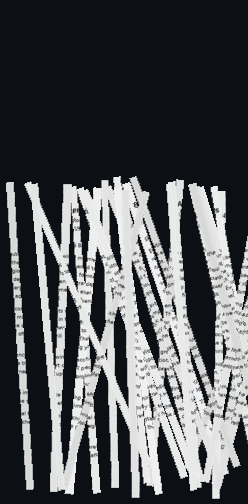
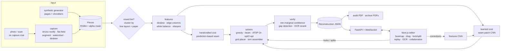
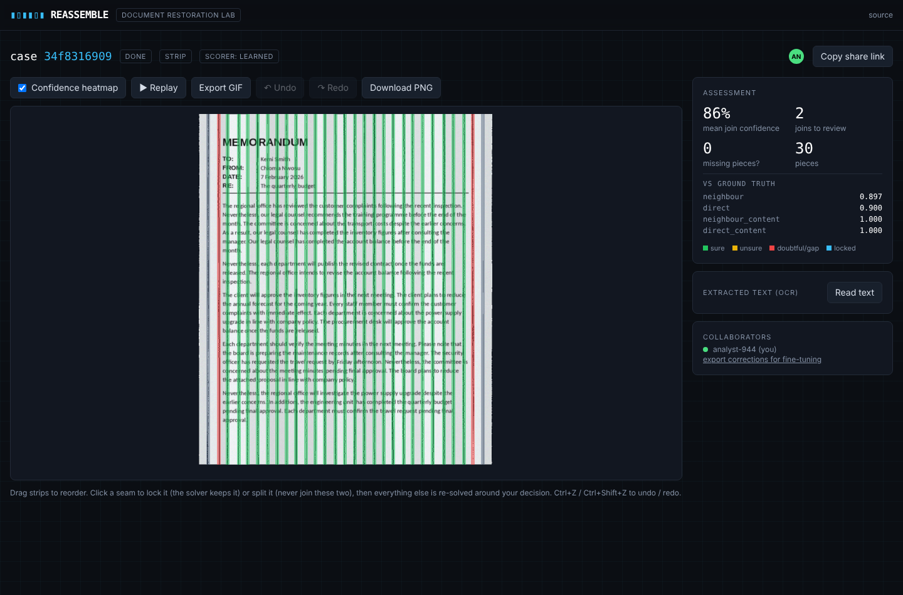
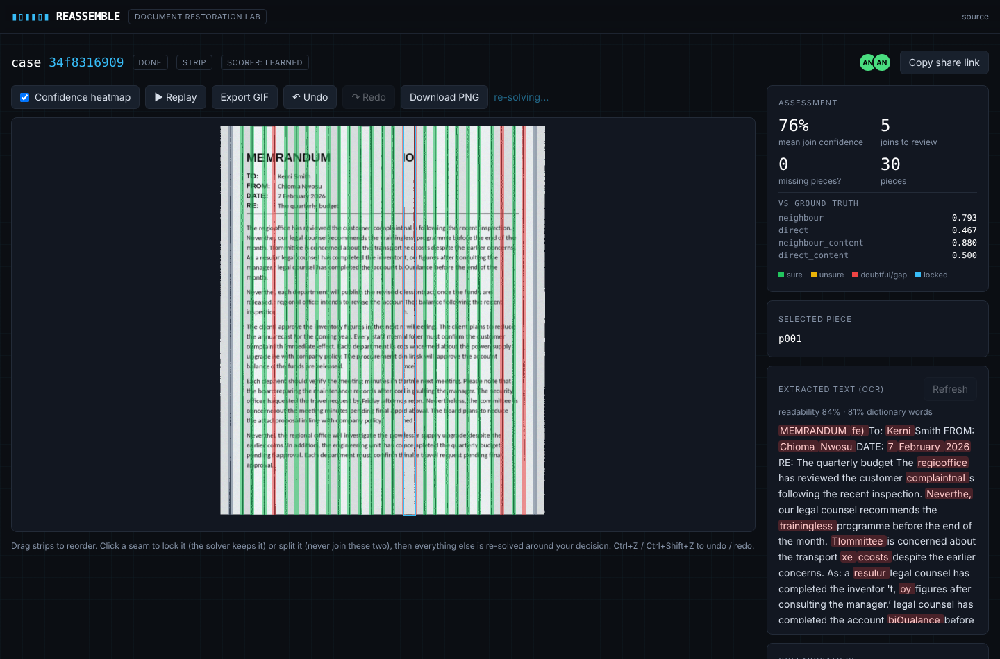
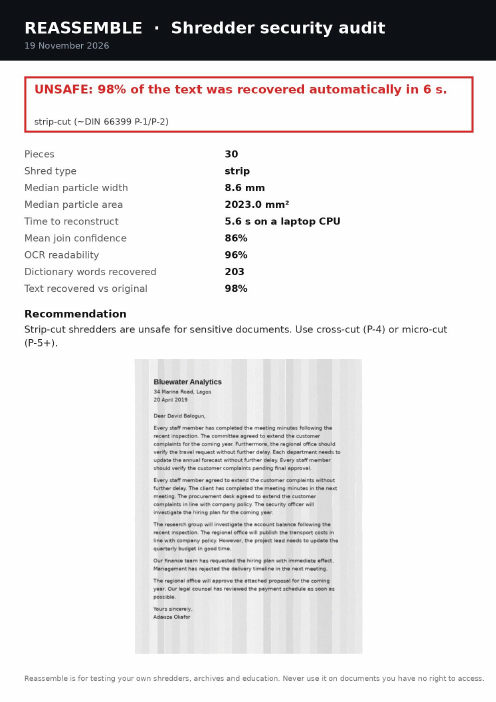
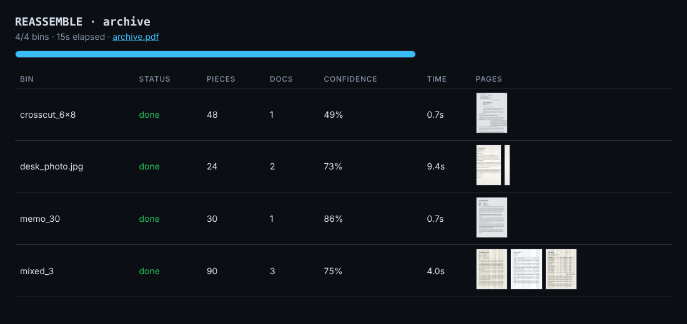

# Reassemble



Reassemble takes scans or photos of shredded paper and rebuilds the original document
digitally. It works like the document-restoration rig in *The Blacklist*, but for real, and
the idea comes from the 2011 DARPA Shredder Challenge. Under the hood it uses computer
vision to score how well piece edges fit (handcrafted *and* a small CNN), a combinatorial
solver to order the pieces, and OCR to check the result. A collaborative web editor lets
people fix what the solver gets wrong.

**Headline numbers** (all on synthetic pages with known ground truth; see the tables below):

* Strip-cut, 30 strips, realistic scan noise: **100 %** of non-blank neighbours correct
  with the learned matcher (96 % handcrafted).
* Strips photographed on the capture mat and segmented automatically: **100 %** of pieces
  found, 83 % of neighbours correct.
* Mixed bins of 3 shredded pages: **95 %** clustering purity.
* Torn paper: **100 %** for upright pieces. Rotated pieces are deskewed from their own text
  lines: at ±3° rotation, 0.08 → 0.54.
* Missing strips flagged by a learned classifier: 0.70 recall at 0.86 precision (CNN scorer).
* Cross-cut: good up to about 4×3 pieces, poor beyond that (honest table and analysis below).

> **Ethics.** Reassemble is for recovering your own documents, testing your organisation's
> shredders, archives and education. Don't use it on documents you have no right to access.

<br clear="right">

## Quick start

```bash
make setup          # venv + Python deps + CPU PyTorch (needs `uv`; also: sudo apt-get install tesseract-ocr)
make demo           # shred a letter, solve it, open result/demo/index.html
make test           # 63 tests, ~1 min
make api            # FastAPI on :8000      ┐  then open http://localhost:3000
make web            # Next.js on :3000      ┘  and press "Try" on a sample
make docker         # or: both services via docker compose
```

Command-line tour (`reassemble …` once installed, or `python -m reassemble.cli …`):

```bash
reassemble synth --out samples                       # every synthetic test case (= make demo-synth)
reassemble solve samples/memo_30_noisy --out result/ # reconstruction.png, heatmap.png, result.json
reassemble solve samples/mixed_3 --out result/mixed --ocr   # mixed bin + OCR rerank
reassemble synth-photo --out samples/photo           # a simulated phone photo of strips on the mat
reassemble capture samples/photo/photo.jpg --out pieces/ && reassemble solve pieces/
reassemble audit samples/letter_30_noisy --out result/audit.pdf   # shredder security report
reassemble archive <dir-of-bins> --out result/archive             # batch mode + dashboard
reassemble bench --suite strips|mixed|double|ocr|crosscut|torn|scorers|capture
reassemble train                                     # retrain the CNN (~2.5 min on CPU)
reassemble train-gaps --scorer learned               # retrain the missing-strip classifier
reassemble finetune corrections.json                 # learn from editor corrections
reassemble mat                                       # printable capture mat PDF
```

## Architecture



Every stage passes the same small data model (`reassemble/model.py`). A `Piece` is an id,
an RGBA image (alpha = paper mask, so ragged and torn edges just work), an optional back
side and metadata. A `Reconstruction` is the order or grid, per-join confidence, gaps and
scores. Everything serialises to JSON for the API.

## Status

| Phase | What | Status |
|---|---|---|
| 0 | Synthetic data generator + digital shredders | ✅ |
| 1 | Strip reconstruction MVP | ✅ |
| 2 | OCR verification & rerank, two-sided matching, mixed-document separation, gap placeholders | ✅ |
| 3 | Learned CNN edge matcher (+ fine-tuning from human corrections) | ✅ |
| 4 | Cross-cut 2D solver, torn-paper shape matching, handwriting/photos | ✅ (cross-cut: partial) |
| 5 | Real-world capture (photo → pieces), capture mat, simulated test photo | ✅ |
| 6 | FastAPI + WebSocket backend, Next.js editor with heatmap, replay, constrained re-solve, collaboration | ✅ |
| 7 | Shredder security audit (PDF report), archive batch mode | ✅ |
| 8 | Polish: README, `make demo`, Docker, tests (88 % coverage; core engine modules 90–100 %) | ✅ |

## How it works (strip shreds)

1. **Normalise each piece.** Estimate the strip's long axis with PCA on the alpha mask,
   rotate it upright, and crop it.
2. **Read the edges.** For each row, find where the paper actually ends (from the alpha
   mask) and read the pixels just inside that point, so frayed or ragged edges still work.
   Colours are white-balanced against the paper tone. If the document looks blurry, edges
   are also sharpened with an unsharp mask (see the results below for why).
3. **Score every ordered pair (A, B).** The main cue is a *prediction-based* seam cost
   (Pomeranz et al.): extrapolate A's last two columns linearly and compare the result with
   B's first column, and do the same from B towards A. The per-row error ignores a band the
   size of the estimated noise, so blank rows don't swamp the signal. Two weak cues are
   added: text-line alignment, weighted by how regular the text lines are, and paper/ink
   colour.
4. **Solve.** The task is to find a Hamiltonian path, which becomes an **asymmetric TSP**
   once a virtual "page border" node is added. A piece is cheap to start or end on when its
   outer edge is blank. Three solvers run:
   * *greedy best-buddies*: link mutual best matches first, then cheapest-first without
     creating cycles (union-find);
   * *beam search* with Held–Karp-style state merging;
   * *ATSP local search* (vectorised Or-opt + asymmetric 2-opt), seeded from both of the
     above.

   The cheapest tour wins. Blank margin strips carry no information, so they are taken out
   of the optimisation and placed at the page edges in whatever way balances the margins.
5. **Confidence per join** is a *min-marginal*: how much the best solution's cost rises if
   that join is forbidden and the rest is re-optimised. A join can look only slightly better
   than the alternatives locally and still be forced by the rest of the solution, so this
   works far better than a local best-vs-second-best ratio.
6. **Gap detection** (missing strips) uses a small **learned classifier** (gradient
   boosting, `solve/joins.py`, one model per scorer). For each join of the solution it
   looks at:
   * cost relative to the page's typical join and to its neighbouring joins;
   * cost relative to the best alternatives, and its rank in both directions;
   * the min-marginal confidence;
   * how much ink touches both edges (a blank seam can't reveal a gap).

   It is trained on generator pages (10–60 strips, clean and noisy) with 0–3 strips
   removed: `reassemble train-gaps`, about 2 min for the handcrafted scorer and 8 min for
   the CNN. The first version, a hand-tuned two-threshold rule, is kept as a fallback when
   no model file exists.

## Results

Benchmark: `reassemble bench`. Each run renders fresh pages (5 per page type, seeds
100–104), shreds them into 30 strips and solves them blind.

* **neighbour**: fraction of true adjacent pairs that are reproduced.
* **direct**: fraction of strips at exactly the right index.
* ***_content***: the same metrics with **blank strips ignored**. The left and right
  margins of a page produce 3–4 completely blank strips whose order cannot be determined
  and does not affect the picture (standard practice in the strip-shredding literature).

**Clean scans, 30 strips** (target ≥ 95 % ✅)

| page | neighbour | neighbour (content) | direct (content) |
|---|---|---|---|
| memo | 0.883 | 0.976 | 0.915 |
| letter | 0.910 | 0.976 | 0.800 |
| invoice | 0.883 | 0.961 | 0.785 |
| photo | 0.931 | 1.000 | 1.000 |
| handwriting | 0.848 | 0.984 | 0.600 |
| **all** | **0.891** | **0.979** | 0.820 |

**Realistic scans** (±0.4° rotation, σ=6 noise, blur σ=0.7, ±6 % brightness, ±8 % width,
3 px ragged cut)

| page | neighbour | neighbour (content) | direct (content) |
|---|---|---|---|
| memo | 0.903 | 0.968 | 0.946 |
| letter | 0.869 | 1.000 | 1.000 |
| invoice | 0.779 | 0.843 | 0.420 |
| photo | 0.890 | 1.000 | 1.000 |
| handwriting | 0.828 | 0.992 | 0.800 |
| **all** | **0.854** | **0.961** | 0.833 |

Solvers compared (neighbour accuracy, all pages):

| solver | clean | realistic |
|---|---|---|
| greedy best-buddies | 0.829 | 0.757 |
| beam search (w=200) | 0.801 | 0.739 |
| ATSP Or-opt/2-opt (kept) | **0.892** | **0.861** |

Runtime is about 0.6–0.8 s per 30-strip page on a laptop CPU, including feature extraction
and confidence computation.

**What made the difference** while tuning (realistic set, content-neighbour accuracy):

| change | before → after |
|---|---|
| model fraying as a *shared* ragged cut line instead of material lost on both sides | 0.05 → 0.95 top-1 match rate on frayed strips |
| white-balance edges by paper colour | 0.37 → 0.93 top-1 with brightness jitter |
| unsharp-mask before matching (only when the scan is blurry) | 0.63 → 0.96 |
| solve on raw costs instead of ratio-normalised ones | ratios of near-zero costs are unstable on blank edges |

## Phase 2: quality features

**OCR verification** (`--ocr`, Tesseract). The pixel matcher only ever sees one seam at a
time, while OCR sees the whole page. The candidate list is the best order plus, for each
join, the re-optimised order with that join forbidden (the same computation as the
confidence), deduplicated and cut to 8. Each candidate is rendered and OCR'd in parallel and
scored by *readability* = 0.6 × fraction of tokens that are dictionary words + 0.4 × mean
OCR confidence. The winner maximises `readability − α·(extra seam cost)`. Joins crossed by
several non-words are flagged as `ocr_suspect` for the editor. Word lists live in
`reassemble/verify/wordlists/`, and you choose them with `--lang en,pcm,yo` (Nigerian
Pidgin and Yoruba ship as small starter lists).

| noisy pages (memo, letter, invoice, handwriting × 6 seeds) | neighbour | neighbour (content) | direct (content) |
|---|---|---|---|
| without OCR | 0.813 | 0.916 | 0.757 |
| **with OCR rerank** | **0.833** | **0.939** | **0.796** |

OCR adds about 2–3 s per page. The best candidate in the list would score 0.941, so OCR
picks almost optimally; what limits it is how good the candidate list is.

**Local English language model** (`verify/lm.py`, `models/char_lm_en.json.gz`, 430 KB).
It is a character 5-gram model with Witten–Bell interpolation. It is trained in about 90 s
on 5.4 M characters of English prose taken from the docstrings of installed Python
packages (deliberately **not** on the generator's sentences). It runs offline, with no API
and no GPU. It cleanly separates real text from seam damage: −2.7 bits/char for a correct
sentence, −4.6 when words are split ("the commit tee has rev iewed"), and −7.5 for garbled
OCR. In the rerank it adds `0.3 × log-prob/char` to readability.

Measured honestly, on held-out seeds 200–205 with the weight tuned on seeds 100–105, it
**changed no decisions**. The dictionary-based rerank already picks the best candidate
every time (0.937, equal to the oracle), and widening the list to 20 candidates only lifts
that ceiling to 0.940. The remaining errors can't be fixed by undoing one join, so a better
scorer can't reach them. The LM stays on because it is neutral here and may help on real
documents with richer language. I also tried it for ordering cross-cut *rows* (does row
A's last line continue into row B's first line?), and it was near chance (see Phase 4).
English only for now.

**Two-sided matching.** When back images exist, the back-side seam cost is added. The back
is stored as you would read it, so "B is right of A on the front" means "A.back is right of
B.back": the back cost matrix is simply **transposed**. Noisy 40-strip double-sided pages,
10 seeds:

| | neighbour | neighbour (content) | direct (content) |
|---|---|---|---|
| front only | 0.759 | 0.864 | 0.485 |
| **front + back** | **0.849** | **0.976** | **0.618** |

**Mixed-document separation** (`solve --mixed`, automatic for mixed cases). All strips of
one page have their text lines at the same heights, so the main cue is the correlation of
smoothed "inside a text line" row profiles: about 0.25 distance within a page versus about
0.9 across pages. Strips are linked to their 4 nearest neighbours when the distance is
< 0.55. Connected components become documents, so the number of documents doesn't have to
be guessed; components that are still similar on median get merged. Blank strips are
assigned by *paper chromaticity* (r,g,b)/(r+g+b), which ignores scan brightness but keeps
the paper's tint. Each document is then solved on its own. Noisy bins, 8 seeds each:

| bin | purity | #docs found correctly | per-document neighbour (content) |
|---|---|---|---|
| 2 pages | 0.981 | 75 % | 0.817 |
| **3 pages** | **0.949** ✅ | 75 % | 0.800 |
| 5 pages | 0.890 | 63 % | 0.805 |

(Silhouette-based agglomerative clustering, the first attempt, got purity of only about
1/k: one giant cluster plus singletons.)

**Missing pieces** show up in renders as red hatched placeholders of median strip width.

## Phase 3: learned edge matcher

`reassemble/match/learned.py` defines a small CNN (4 conv layers, about 70k parameters).
It looks at a **seam patch**: 32 rows × (last 8 px of A + first 8 px of B) × RGB, read
relative to the paper boundary. It outputs P(true neighbours). This is the early-fusion
design from Paixão et al.: the convolutions see both sides at once, so they learn stroke
continuity directly. A pair's cost is the mean −log P over its *informative* patches (those
with some ink); blank patches are skipped.

* **Data comes free from the generator.** 80 random pages, each shredded into 20–45 strips
  with random realism (60 % noisy, 30 % extra blur). Positives are true neighbours.
  Negatives are *hard*: other strips of the same page, including near-misses 2–3 strips
  away. Training augments with ±1 px vertical shifts and brightness jitter.
* **Held-out fonts.** Training uses Liberation Serif/Sans/Mono, DejaVu Sans, FreeSerif and
  Caveat. Validation uses Caladea, Carlito, DejaVu Serif and Indie Flower.
* **CPU-trainable.** `reassemble train` takes about **2.5 minutes** on 4 CPU cores
  (77k training patches, 6 epochs, about 81 % single-patch validation accuracy). Weights are
  in `models/edge_cnn.pt` (280 KB).
* `--scorer auto` (the default) uses the CNN when PyTorch and the weights are available,
  and the handcrafted scorer otherwise.
* **Human-in-the-loop hook:** `reassemble finetune corrections.json` fine-tunes on pairs
  exported from the editor: label 1 for locked joins, 0 for split ones. Human pairs are
  upweighted ×4 and mixed with replayed synthetic data so the model doesn't forget.

**Scorer comparison** (content-neighbour accuracy, 4 pages per condition, seeds 700–703):

| condition | handcrafted | learned | combined |
|---|---|---|---|
| clean | 1.000 | 1.000 | 0.992 |
| realistic noise | 0.858 | **1.000** | 1.000 |
| heavy noise + blur (σ=10, blur 1.2) | 0.404 | **1.000** | 0.953 |
| handwriting (noisy) | 1.000 | 1.000 | 1.000 |
| 60 strips (noisy) | 0.684 | **1.000** | 0.990 |
| **held-out fonts** (noisy) | 0.910 | **1.000** | 1.000 |

With the learned scorer, the standard benchmark (`reassemble bench --scorer learned`,
4 pages × 5 types) reaches **1.000 content-neighbour accuracy** on clean, noisy and
noisy-with-2-missing-strips pages. Gap detection (missing strips, noisy pages, 2 removed):

| gap detector | recall | precision | content accuracy on intact pages |
|---|---|---|---|
| hand-tuned rule, handcrafted scorer | 0.14 | 0.20 | 0.961 |
| **learned classifier**, handcrafted scorer | **0.28** | **0.42** | 0.958 |
| hand-tuned rule, CNN scorer | 0.38 | 0.68 | 1.000 |
| **learned classifier**, CNN scorer | **0.70** | **0.86** | 0.998 |

The last column checks the cost of false alarms on pages with nothing missing. The cost is speed: about 3 s per 30-strip page on CPU instead of
about 0.7 s. "Combined" (average of the two normalised costs) never beat the CNN alone.

## Phase 4: harder shred types

**Cross-cut (2D)**, `reassemble/solve/grid.py`. Top/bottom costs come from the *same*
matcher applied to **transposed** pieces. Two placers run, and the cheaper result wins:
* a Pomeranz/Paikin-style greedy placer on a floating grid, which fills the most confident
  slot first and prefers slots with more placed neighbours;
* *rows-then-stack*: an ATSP with `rows` copies of the border node splits all pieces into
  rows, then whole rows are stacked using the **summed** top/bottom cost down every column.

A swap/cyclic-shift local search refines both. Costs are ratio-normalised, which matters
in 2D: with raw costs, wrong layouts that push every inky edge onto the outer border scored
better than the truth. Clean letters and memos, 3 seeds each:

| grid | piece size | neighbour | neighbour (content) | direct | time |
|---|---|---|---|---|---|
| 3×2 | 425×366 px | 0.952 | 0.952 | 0.833 | 0.25 s |
| 4×3 | 283×275 px | 0.804 | 0.810 | 0.167 | 0.28 s |
| 6×5 | 170×183 px | 0.595 | 0.635 | 0.356 | 0.36 s |
| 8×6 | 141×137 px | 0.402 | 0.429 | 0.056 | 0.52 s |
| 10×8 | 106×110 px | 0.270 | 0.318 | 0.015 | 0.91 s |

Honest assessment: this is the weakest part of the project. Left/right matching is decent
(top-1 about 0.75), but **top/bottom matching is poor** (top-1 about 0.2). About half of
all horizontal cuts fall in the blank space between text lines, so there's nothing to
match.

A second round of fixes, all measured and all **not adopted** because none helped:

| idea | what it measures | result |
|---|---|---|
| text-line *phase* across a cut (`line_phase_cost`) | do lines continue with the page's line spacing? | no consistent gain |
| stack rows by *raw* instead of ratio-normalised summed TB cost | — | worse (0.29–0.50 vs 0.43–0.65 next-row top-1) |
| line phase measured on whole assembled rows | — | 0.31–0.43 next-row top-1 |
| local LM: does row A's last line continue into row B's first? | sentence continuity | near chance (0–0.4) |
| CNN scorer for the 2D costs | — | no better; it was trained on vertical seams only |

The diagnosis is structural. Text lines span the whole page, so when a horizontal cut falls
between two lines it is blank across the **entire row**, and no per-piece or per-row
pixel cue can see through it. Even when given *perfectly assembled rows*, picking the next
row is right only 33–80 % of the time. A real fix would need page-level reasoning
(paragraph layout, margins, reading order with a much stronger language model). That is
future work.

**Torn paper**, `reassemble/solve/torn.py`. A tear is a shared curve. If B sits at offset
(dx, dy) to the right of A, then `x_A(y) + 1 − x_B(y − dy)` must be constant across the
overlapping rows. We search every dy, take dx as the median, and use the trimmed mean
absolute deviation as the **shape cost**. Colours read 4 px inside each boundary (past the
white fibre rim) add a content-continuity term. Rows lying on the page's own straight edge
are excluded. Pieces are assembled Kruskal-style by ratio-normalised match quality, and any
merge that would make pieces overlap is rejected.

| torn pages (memo, letter, photo, handwriting × 3 seeds) | 2×4 pieces | 3×4 pieces |
|---|---|---|
| clean, 14 px tears | **1.000** | **1.000** |
| clean, subtle 6 px tears | 1.000 | 1.000 |
| noisy (no rotation) | 1.000 | 1.000 |
| noisy + ±0.4° rotation | 0.558 | 0.613 |

**Rotated torn pieces.** A real photo never has pieces perfectly upright. Each piece is now
deskewed *on its own* from its text lines (`text_angle`, classic projection-profile
deskew: the angle at which the ink's horizontal profile is sharpest). Then the exact
upright assembler runs. This only kicks in when the median measured skew is above 0.4°,
since below that the estimation error (about 0.15°) is as big as the rotation. Same pages
and seeds, before → after:

| rotation | 2×4 pieces | 3×4 pieces |
|---|---|---|
| ±0.4° | 0.47 → 0.49 | 0.63 → 0.63 |
| ±1.5° | 0.28 → **0.53** | 0.32 → **0.62** |
| ±3° | 0.12 → **0.48** | 0.08 → **0.54** |

This is a real improvement but not a full fix: residual angle errors of a few tenths of a
degree still break about half the matches. Approaches that failed and are kept in the code
as documentation:
* chaining *relative* angles from tear-edge tilts along a spanning tree: errors accumulate,
  and rotated straight page edges produced perfect bogus matches until a straightness
  test (`_straight`) excluded them;
* least squares over all confident relations: wrong matches pollute it.

**Handwriting and photos.** The baseline cue is weighted by each strip's text-line
regularity, so it fades out for handwriting and photos, and the pixel/CNN seam cost carries
those cases (handwriting: 1.000 with either scorer; photos: 1.000 content accuracy).

## Phase 5: real-world capture

```bash
reassemble mat                                   # printable capture mat -> assets/capture_mat.pdf
reassemble synth-photo --out samples/photo       # simulated phone photo you can reproduce
reassemble capture samples/photo/photo.jpg --out pieces/
reassemble solve pieces/ --out result/photo      # -> content-neighbour 1.000 on this photo
```

The pipeline lives in `reassemble/capture/pipeline.py`:

1. **Rectify.** If at least 3 of the 4 ArUco markers on the printed mat are found, their
   corners give a homography into the mat frame, rendered at 2× (about 200 dpi).
2. **Flat-field.** The light field is estimated from the paper itself (a normalised
   convolution over paper pixels on a 1/16-scale image) and divided out. Doing this at full
   resolution was 80× slower for the same result.
3. **Segment.** Otsu threshold on lightness, then morphology and hole filling. Touching
   pieces are split by a distance-transform **watershed**, but only when the cores sit side
   by side *across* the blob's long axis. Several cores *along* one strip just mean ink
   dents in the mask.
4. **Per piece.** Deskew with the PCA long axis, rotating colour and mask *separately*.
   **Repair the edges.** Dark ink touching a cut edge looks like background to a threshold,
   so the mask gets dented exactly where the most useful pixels are. Each boundary is
   snapped to a rolling-median line and only real outward bulges are kept. Then shave
   **2 px** of mixed paper/background colour (1 px leaves a dark fringe that reads as ink;
   3 px throws away too much). Finally crop to RGBA and normalise heights.

The output is the same `Piece` format as the generator, so everything downstream works
unchanged.

The **simulated photo** (`reassemble/synth/photo.py`) scatters the strips on a dark
fabric-textured mat with ±1.2° rotation and uneven spacing. It adds a lighting gradient,
vignetting, a random perspective, sensor noise and JPEG compression.

| 10 simulated photos (5 page types × 2 seeds, 24 strips) | result |
|---|---|
| pieces found and segmented correctly | **100 %** |
| content-neighbour, handcrafted scorer | 0.781 |
| content-neighbour, learned scorer | **0.828** |

What I learned debugging this: **resolution matters more than anything**. At the
generator's 100 dpi, letter strokes are about 2 px wide, and any real capture loses about
1 px at each cut, so accuracy collapsed to about 0.1. Capturing at 2× (still below a
typical phone photo or a 300-dpi flatbed scan) brought it to about 0.8.

## Phase 6: web app and human in the loop

```bash
make api    # FastAPI on :8000   (OpenAPI docs at /docs)
make web    # Next.js on :3000   (set NEXT_PUBLIC_API_URL if the API is elsewhere)
```



**Backend** (`api/main.py`). You can upload piece images or one photo (which is segmented
by the capture pipeline), or start from a sample. Each job solves in a worker thread and
streams solver progress over `/ws/jobs/{id}`. Edits go through REST:

* `POST /order`: a manual reorder. Join costs and confidences are recomputed with the
  cached cost matrix.
* `POST /resolve`: lock or split joins, then **re-solve the rest with those constraints
  fixed**. Locked pairs are compiled into the ATSP matrix, so every solver respects them.
* `POST /move_doc`: move a piece to another document, then re-solve the documents.
* `GET /ocr`: text with dictionary flags.
* `GET /replay.gif`: the shareable animation.
* `GET /corrections`: locks and splits as training pairs for `reassemble finetune`.

**Collaboration.** Every edit is stamped with a server-side `seq` and broadcast to
everyone, and clients drop any state older than the one they hold (last write wins, in
server order). Cursors and live drag previews are relayed over the same socket, and the
header shows who is online. Open the share link in two windows to try it.

**Frontend** (`web/`, Next.js App Router + TypeScript + Tailwind):
* upload / try-a-sample screen;
* the reconstruction board, with seams coloured by confidence (toggleable): green sure,
  yellow unsure, red doubtful or gap, blue locked;
* drag strips to reorder; click a seam to lock or split it; undo/redo with Ctrl+Z;
* a ▶ Replay animation of the pieces flying from a pile into place in solve order, plus a
  GIF export;
* a tab per document for mixed bins, with "move to" for the selected piece;
* an OCR panel with uncertain words highlighted. In the screenshot below, one strip was
  dragged to the wrong place on purpose: its seams turn red and the OCR panel flags the
  garbled words.



On screens narrower than 768 px the board is read-only.

An end-to-end browser test (Playwright, two simulated users) covered: load a sample, solve,
see both users online, drag a strip, read OCR, lock a seam and re-solve. It produced no
console errors.

## Phase 7: product angles

**Shredder security audit.** Feed in the output of *your own* shredder: a folder of
scanned pieces, or one photo on the capture mat.

```bash
reassemble audit samples/letter_30_noisy --out result/audit.pdf
# UNSAFE: 98% of the text was recovered automatically in 6 s.
#   strip-cut (~DIN 66399 P-1/P-2); 30 pieces, width 8.6 mm, solved in 5.6s
#   Strip-cut shredders are unsafe for sensitive documents. Use cross-cut (P-4) or micro-cut (P-5+).
```

The audit reconstructs the pile, OCRs the result, and reports particle size, time taken,
mean join confidence, readability, and **% of text recovered**. That last figure is exact
(word overlap with the OCR of the original) when you pass `--original` or the case has an
`original.png`, and estimated otherwise. It then gives a plain-language verdict in the
spirit of DIN 66399. A large-particle cross-cut (10×12 pieces of 18 mm) was also flagged
**UNSAFE, 52 % of text recovered**, even though the 2D solver assembled it poorly. Pieces
that big contain whole words on their own, and that is precisely the security point.



**Archive mode.** `reassemble archive <dir> --out result/archive` treats every entry as
one bin: a case folder or a photo. It reconstructs each bin, separating mixed documents,
and writes a PDF per bin plus `archive.pdf` with every page. Along the way it keeps a
self-refreshing `index.html` dashboard and a `status.json` up to date. A broken bin is
reported and skipped; it doesn't stop the run.



## Phase 8: polish

* `make demo` shreds a letter into 30 noisy strips, solves it, and writes
  `result/demo/index.html` with the replay GIF, the reconstruction, the heatmap and the
  original. It opens the page if a browser is available.
* `docker compose up --build` starts the API (Python 3.12 slim + Tesseract + CPU PyTorch,
  with the samples pre-generated) and the web app (Next.js standalone build).
  `docker compose config` validates, but **the images were not built in the development
  environment** because it had no Docker daemon. Treat the Dockerfiles as untested.
* Tests: 57 pytest tests, 88 % line coverage overall. Core-engine modules are at 90–100 %;
  the lowest are `solve/grid.py` (78 %) and the CLI (76 %). The suite covers the
  generator, every solver, the CNN (a training smoke test), capture, the API (via
  `TestClient`, including WebSockets), the audit/archive features and every CLI command.

## Known limitations (honest list)

* **Blank strips** can't be ordered. They are placed at the margins, but which blank strip
  goes where is a coin toss, which is why raw neighbour accuracy sits around 0.85–0.9.
* **Monospace fonts** are hard. In a monospaced page, the whitespace between characters
  lines up vertically across every line, so many cuts land in blank columns (about 0.68
  content accuracy on that seed).
* **Gap detection** is now decent with the CNN scorer (0.70 recall / 0.86 precision) but
  still modest with the handcrafted one (0.28 / 0.42). Smooth photos remain the hardest
  case: a gradient extrapolates across a missing strip almost seamlessly.
* Noisy **invoices** are the hardest printed case (0.84). Their table rules repeat the same
  pattern on many strips.
* **Rotated torn pieces** are only partly solved: deskewing from text lines brings ±1.5–3°
  rotations from 0.1–0.3 up to 0.5–0.6, but not to the 1.00 of upright pieces. Pieces
  without text lines (photos) borrow the median angle of the others.
* **Cross-cut beyond about 6×5 pieces** is mostly wrong. Four further ideas were tried
  and measured without gain (see Phase 4); the limit is structural.
* **The local language model** measurably changed nothing on the benchmark (see Phase 2).
  It is English only.
* The document clustering can split off a few blank margin strips as an extra "document"
  (seen on a captured photo in archive mode).
* **Web editor**: dragging, locking and splitting are implemented for strip shreds. Cross-cut
  and torn results are shown read-only. Jobs live in server memory (plus `runs/` on disk)
  and don't survive an API restart.
* **Capture** assumes strips are laid roughly upright (within ±45°). A strip that is upside
  down can't be told apart, and capture is not yet tuned on real photos; the mat, threshold
  and erosion values were chosen on simulated ones. **Next step needs a person:** print
  `assets/capture_mat.pdf`, photograph real strips on it, and run
  `reassemble capture photo.jpg --out pieces/ && reassemble solve pieces/`.
* Mixed bins: two pages built from the *same template* (two memos) have nearly identical
  line layouts and can merge into one cluster. The number of documents is right about 75 %
  of the time; when it's wrong, it's usually over-segmentation.

## Project layout

```
reassemble/
  synth/      page renderer (memo, letter, invoice, photo, handwriting) + shredders
  features/   deskew/normalise, edge reading, text-line features
  match/      pairwise edge costs (handcrafted + learned CNN)
  solve/      strips: greedy, beam, ATSP; grid.py: cross-cut; torn.py: torn paper
  verify/     Tesseract OCR readability, reranking, word lists (en, pcm, yo)
  cluster/    mixed-bin document separation
  capture/    photo -> pieces (ArUco rectification, flat-field, watershed, edge repair), mat PDF
  render/     assembled image, confidence heatmap, replay GIF
  product/    shredder security audit (PDF), archive batch mode (PDF + dashboard)
  metrics.py  neighbour / direct accuracy, gap precision/recall, mixed-bin purity
  pipeline.py prepare -> score -> solve -> Reconstruction
  bench.py    every benchmark quoted in this README
  cli.py      `reassemble ...` commands
api/          FastAPI + WebSocket server
web/          Next.js editor (App Router, TypeScript, Tailwind)
models/       trained CNN weights (edge_cnn.pt, 300 KB)
assets/       capture mat PDF, screenshots, replay GIF
tests/        pytest suite
```

## Credits & references

* DARPA Shredder Challenge (2011).
* D. Pomeranz, M. Shemesh, O. Ben-Shahar, "A fully automated greedy square jigsaw puzzle
  solver", CVPR 2011.
* A. Gallagher, "Jigsaw puzzles with pieces of unknown orientation", CVPR 2012.
* T. M. Paixão et al., "A deep learning-based compatibility score for reconstruction of
  strip-shredded text documents" (SIBGRAPI 2018), and follow-up work on self-supervised
  and cross-cut reconstruction (2019–2020). The early-fusion seam-patch CNN follows their idea.
* G. Paikin and A. Tal, "Solving multiple square jigsaw puzzles with missing pieces",
  CVPR 2015 (best-buddy confidence ordering).
* S. Lin and B. Kernighan, "An effective heuristic algorithm for the traveling-salesman
  problem", 1973 (the Or-opt/2-opt local search is a stripped-down LK).
* Tesseract OCR; OpenCV (ArUco markers); word list from SCOWL/`wamerican`.
* Handwriting fonts: Caveat and Indie Flower (SIL Open Font License), from Fontsource.

Built by Odunayo (University of Lagos) as a portfolio / hackathon project.
